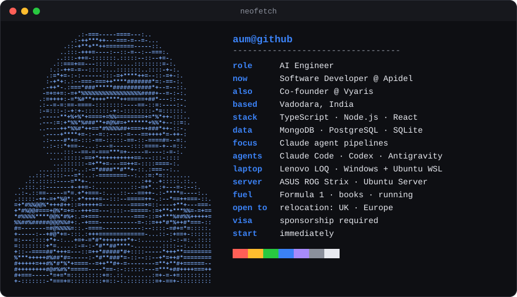

<div align="center">



**[Portfolio](https://aumpatel2624.github.io/portfolio/)** · **[LinkedIn](https://www.linkedin.com/in/aum-patel-945561222/)** · **[Email](mailto:aumpatelc36@gmail.com)**

`Open to relocation (UK and Europe)` · `Requires visa sponsorship` · `Available immediately`

</div>

## 👋 Hi, I'm Aum

I'm an AI engineer from Vadodara, India. I build AI agent pipelines with **research, fact-check and human review** stages. By day I'm a software developer at Apidel Technologies, and I co-founded Vyaris, a six-person software agency. Away from the editor you'll find me watching Formula 1, tinkering with hardware, and trying to turn reading into a habit.

<div align="center">



</div>

## ⚙️ How I build

I develop with Claude Code, Codex and Antigravity to cut the time from idea to finished product. This is the shape of the content pipeline I built at Vyaris:

```text
 +----------+    +----------+    +-------+    +--------------+    +--------------+
 | ideation |--->| research |--->| draft |--->|    checks    |--->| human review |---> ship
 +----------+    +----------+    +-------+    |  fact-check  |    +--------------+
                                     ^        |  SEO         |
                                     |        |  brand voice |
                                     |        |  compliance  |
                                     |        +------+-------+
                                     +--- revise ----+
```

## 🛠️ Things I've made

- 🧩 **[claude-code-agents](https://github.com/aumpatel2624/claude-code-agents)**: 9 specialised Claude Code agents that turn a request into an XML spec and route it to backend or frontend work.
- ✍️ **AI content generator** (Vyaris): a 7-stage Claude Agent SDK pipeline for LinkedIn posts and blogs.
- 🎙️ **Podcast knowledge pipeline**: 58 episodes analysed, with transcript quotes checked in code.
- ♻️ **SmartBin**: a waste-sorting prototype where a TensorFlow model tells an Arduino how to sort.

## 🧭 Off the clock

```text
~/aum/hobbies
├── f1/        team: Red Bull · driver: Max Verstappen
│              best race watched: 2016 Brazil Grand Prix
├── books/     now: Read People Like a Book, Psycho-Cybernetics
├── running/   just started
├── esports/   Valorant tournaments, and lately some football
├── iot/       Arduino + camera module; college project ran ML on board
└── ai/        use cases beyond coding
```

## 🏠 Homelab

```text
 +----------------+   private    +---------------------+   ethernet   +----------------+
 |  Lenovo LOQ    |   network    |  ROG Strix server   |              | Raspberry Pi 2 |
 |  Windows + WSL |<============>|  Ubuntu Server 24/7 |<------------>| network helper |
 +----------------+              |  Docker, KVM/QEMU   |              +----------------+
                                 +---------------------+               next: Wake-on-LAN
```

## 🌍 I speak

**English** (fluent) · **हिन्दी** Hindi (fluent) · **ગુજરાતી** Gujarati (native) · **Deutsch** German (intermediate) · **日本語** Japanese (basic)

---

<div align="center">

```text
                   __
    __            /o \___
   |  |__________/  ___  \_________
   |__|   ___                ___   \______
      \__/ O \______________/ O \_________>
         \___/              \___/
```

*Lights out and away we go.* **[Let's talk](mailto:aumpatelc36@gmail.com)** 🏁

</div>
